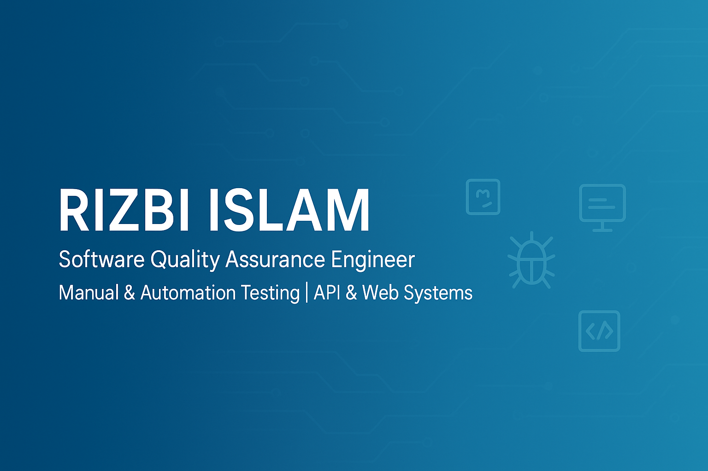

  

# 👋 Hi, I'm **Rizbi Islam**

🎯 **Software Quality Assurance (SQA) Engineer**
💻 *Manual Testing | API Testing | Performance/Load Testing | Growing into UI Automation*
📍 Dhaka, Bangladesh
📧 **Email:** [rizbi.cse@gmail.com](mailto:rizbi.cse@gmail.com)
🔗 **LinkedIn:** [linkedin.com/in/rizbi-islam](https://linkedin.com/in/rizbi-islam)
💻 **GitHub (Profile):** [github.com/rizbi-islam](https://github.com/rizbi-islam)
💻 **GitHub (Projects):** [github.com/rizbiislam](https://github.com/rizbiislam)
🌐 **Portfolio:** [rizbi-islam.github.io/profile](https://rizbi-islam.github.io/profile)

---

## 🧠 About Me

I'm an SQA Engineer with hands-on, production experience in **manual testing**, **REST API testing**, and **automated performance/load testing** — including QA work on live government revenue-management systems in Bangladesh.

I'm currently expanding into **UI test automation** (Selenium, Playwright, Cypress) through self-directed projects, building toward a full-stack automation skill set on top of a solid manual + API testing foundation.

I'm focused on:
- 🐞 Manual + API testing that catches real production issues before users do
- ⚡ Automated load/performance testing with **Locust** & **JMeter**
- 🤖 Building UI automation skills with **Selenium**, **TestNG**, **Playwright** & **Cypress**
- 🔁 Agile QA practices and full defect lifecycle ownership

---

## 🧰 Technical Skills

| Category | Tools & Technologies |
|---|---|
| **Manual Testing** | Functional, Regression, Smoke, UAT, Cross-Browser Testing |
| **API Testing** | Postman, Newman, REST API Validation |
| **Performance / Load Testing** | Locust (Python), Apache JMeter |
| **UI Automation** *(self-directed)* | Selenium WebDriver, TestNG, Playwright, Cypress, Pytest |
| **Languages** | Python, JavaScript, Java |
| **Databases** | SQL, MySQL |
| **Reporting & Tools** | Allure Report, TestRail, Jira, Git/GitHub, GitHub Actions |
| **Other** | Docker, Kubernetes (basics) |
| **Methodologies** | Agile/Scrum, SDLC/STLC, Page Object Model, Data-Driven Testing |

---

## 💼 Experience

**IT Executive & QA Engineer**
*RK Software (Bangladesh) Limited | Dhaka | March 2025 – Present*
- Performed manual testing (functional, regression, smoke) across full-stack web applications
- Conducted REST API testing and validation using Postman
- Designed and ran automated load tests using Locust (Python), surfacing backend bottlenecks under concurrent traffic
- Managed the full defect lifecycle — reporting, root-cause tracking, retesting, sign-off coordination
- Provided QA support on a government revenue-management system upgrade (Dhaka North City Corporation — DNCC)

**QA Engineer (Part-time)**
*IT Directorate, Bangladesh Army — Remote | March 2024 – November 2024*
- Performed manual and functional testing of application workflows
- Executed performance and load testing using JMeter and Locust
- Supported automated test execution using Selenium WebDriver with Python
- Participated in Agile/Scrum sprints, collaborating with cross-functional teams

---

## 🧩 Personal Automation Projects *(Self-Directed Learning)*

*Independent projects built to develop UI and API automation skills — not affiliated with an employer.*

### 🧪 [SauceDemo Automated Testing](https://github.com/rizbiislam/saucedemo-test)
- Selenium WebDriver + TestNG framework built with the Page Object Model (POM)
- Allure Reporting integrated for detailed test result visualization
- Automated login, add-to-cart, and checkout workflows

### 🔗 [Demo Evershop — API & Web Automation Testing](https://github.com/rizbiislam/Api-Testing-Demo-evershop)
- Automated REST API tests using Postman & Newman with HTML reporting
- Selenium-based web automation framework following POM architecture

---

## 🎓 Education

**B.Sc. in Computer Science & Engineering (CSE)**
*Daffodil International University* — Graduated 2023

---

## 📜 Certifications

- **SQA: Manual and Automated Testing** — ostad.app (2023)
- **API Testing with Postman** — Udemy
- **Playwright Test Automation** — Test Automation University
- **Introduction to Docker and Kubernetes** — Styava.dev

---

## 📄 Download My CV

> 📥 [**Download Rizbi_Islam_Resume (PDF)**](https://github.com/rizbiislam/rizbiislam/blob/main/Rizbi_Islam_Resume.pdf)

---

## 📈 GitHub Stats

  
  

---

## 🤝 Let's Connect

💬 Open to collaborations, SQA roles, and automation testing projects.
📩 Reach me at **[rizbi.cse@gmail.com](mailto:rizbi.cse@gmail.com)**

---

⭐ *_"Quality is never an accident; it is always the result of intelligent effort." — John Ruskin_*
